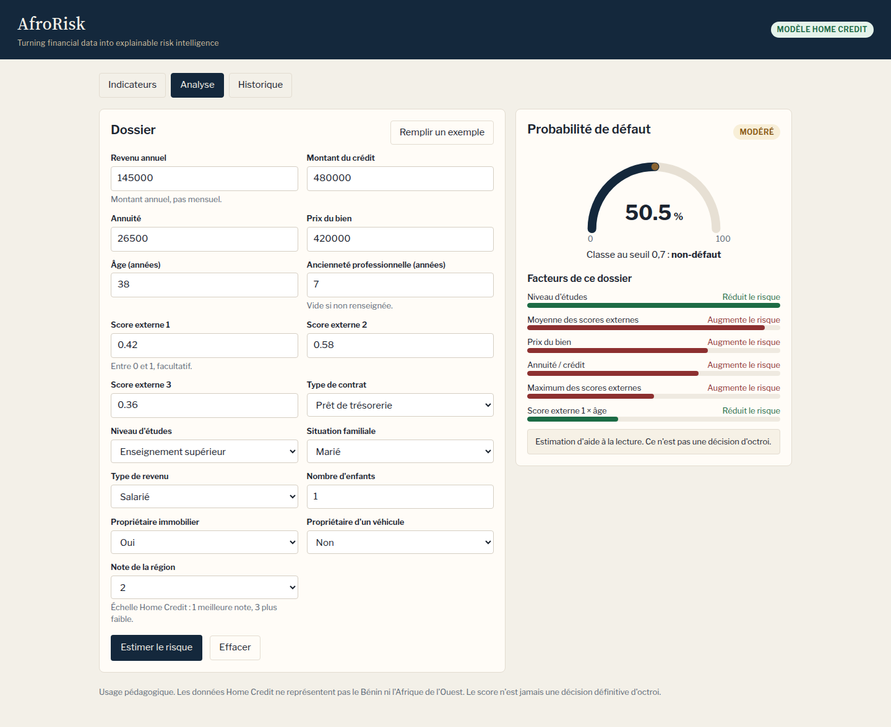

# AfroRisk AI

Démo : [application](https://afrorisk-ai.onrender.com) · [API](https://afrorisk-api.onrender.com) ([/health](https://afrorisk-api.onrender.com/health), [/docs](https://afrorisk-api.onrender.com/docs)).



Sur l'offre gratuite de Render, l'API se met en veille après environ 15 minutes d'inactivité. La première requête peut alors prendre 30 à 60 secondes.

Estimation du risque de défaut de crédit, avec les facteurs qui poussent le score vers le haut ou vers le bas.

AfroRisk AI — Turning financial data into explainable risk intelligence.

Le service sert à lire un dossier. Il ne décide pas d'accorder ou de refuser un crédit. La [carte du modèle](docs/MODEL_CARD.md) précise l'usage prévu, les métriques et les limites.

## Architecture

```text
data/raw ou data/fixtures
        │
        ▼
agrégations (bureau, bureau_balance, previous_application,
             POS_CASH_balance, installments_payments, credit_card_balance)
        │
        ├── modèle de recherche (toutes les variables construites)
        └── modèle servi (formulaire, saisies + variables dérivées, sans le sexe)
                │
                ▼
             SHAP  →  FastAPI  →  interface React
```

| Couche | Rôle |
| --- | --- |
| Données | CSV Home Credit, ou fixture synthétique si `data/raw` est vide |
| Variables | Nettoyage, ratios, agrégations historiques connues à la date de la demande |
| Modèles | Régression logistique, arbre, forêt aléatoire, XGBoost, LightGBM |
| Explications | SHAP global (échantillon) et SHAP local (un dossier) |
| API | FastAPI : `/predict`, `/health`, `/metrics-summary`, `/docs` |
| Interface | React (Vite) : indicateurs, formulaire, jauge, facteurs, historique local |

MLflow enregistre les métriques de chaque comparaison dans `mlruns/` (non versionné). L'historique des simulations reste dans le navigateur (`localStorage`) : pas de base PostgreSQL.

## Résultats

<!-- RESULTS:START -->
> Entraînement sur **Home Credit Default Risk** (307511 demandes, taux de défaut 8.1%). Usage pédagogique : ce n'est pas une décision d'octroi.

Validation croisée stratifiée : 5 plis. Le modèle retenu dans chaque portée est celui qui a le ROC-AUC hors échantillon le plus élevé. Précision, rappel et F1 sont calculés au seuil qui minimise le coût 5 × faux négatifs + 1 × faux positifs.

Le modèle servi n'utilise pas le sexe (`CODE_GENDER`) : la variable a été retirée du formulaire, de l'API et des features exposées.

### Comparaison avec la première version

La première version était évaluée en 3 plis, avec moins de variables dérivées, et le sexe figurait encore parmi les features du modèle servi.

| Portée | ROC-AUC | PR-AUC | Précision | Rappel | F1 | Seuil |
| --- | ---: | ---: | ---: | ---: | ---: | ---: |
| Modèle servi | 0.762 (+0.008) | 0.246 (+0.008) | 0.267 (+0.007) | 0.359 (+0.008) | 0.307 (+0.008) | 0.70 → 0.70 |
| Modèle de recherche | 0.793 (+0.017) | 0.289 (+0.025) | 0.274 (+0.024) | 0.457 (-0.007) | 0.342 (+0.018) | 0.65 → 0.65 |

### Modèle servi (variables du formulaire)

Modèle retenu : **LightGBM**. Seuil de décision : **0.70**.

| Modèle | ROC-AUC | PR-AUC | Précision | Rappel | F1 | Seuil |
| --- | ---: | ---: | ---: | ---: | ---: | ---: |
| LightGBM | 0.762 | 0.246 | 0.267 | 0.359 | 0.307 | 0.700 |
| XGBoost | 0.762 | 0.246 | 0.267 | 0.359 | 0.306 | 0.700 |
| Forêt aléatoire | 0.745 | 0.227 | 0.247 | 0.352 | 0.291 | 0.650 |
| Régression logistique | 0.744 | 0.225 | 0.250 | 0.337 | 0.287 | 0.700 |
| Arbre de décision | 0.723 | 0.206 | 0.225 | 0.363 | 0.278 | 0.700 |

Matrice de confusion du modèle servi, au seuil retenu, sur les prédictions hors pli (lignes = réel, colonnes = prédit, ordre non-défaut / défaut) : `[[258244, 24442], [15902, 8923]]`.

### Modèle de recherche (application + agrégations)

Modèle retenu : **LightGBM (moyenne de germes)**.

| Modèle | ROC-AUC | PR-AUC | Précision | Rappel | F1 | Seuil |
| --- | ---: | ---: | ---: | ---: | ---: | ---: |
| LightGBM (moyenne de germes) | 0.793 | 0.289 | 0.274 | 0.457 | 0.342 | 0.650 |
| LightGBM | 0.791 | 0.285 | 0.270 | 0.460 | 0.340 | 0.650 |
| XGBoost | 0.790 | 0.283 | 0.260 | 0.485 | 0.339 | 0.650 |
| Régression logistique | 0.775 | 0.258 | 0.269 | 0.402 | 0.323 | 0.700 |
| Forêt aléatoire | 0.759 | 0.242 | 0.239 | 0.423 | 0.305 | 0.600 |
| Arbre de décision | 0.724 | 0.203 | 0.223 | 0.367 | 0.278 | 0.700 |

Les facteurs SHAP globaux du modèle servi sont dans `reports/metrics.json` (`served.global_factors`) et sur le tableau de bord.
<!-- RESULTS:END -->

Les figures d'exploration sont produites dans `reports/figures/` par la même commande. Le détail machine est dans `reports/metrics.json` et `reports/eda_summary.json`.

## Variables du formulaire

Le modèle servi ne reprend pas les centaines de colonnes brutes. L'analyste saisit :

| Saisie | Colonne d'origine |
| --- | --- |
| Revenu annuel | `AMT_INCOME_TOTAL` |
| Montant du crédit | `AMT_CREDIT` |
| Annuité | `AMT_ANNUITY` |
| Prix du bien | `AMT_GOODS_PRICE` |
| Âge | `DAYS_BIRTH` |
| Ancienneté professionnelle | `DAYS_EMPLOYED` (la valeur sentinelle 365243 devient manquante) |
| Scores externes 1, 2 et 3 | `EXT_SOURCE_1`, `EXT_SOURCE_2`, `EXT_SOURCE_3` |
| Situation familiale | `NAME_FAMILY_STATUS` |
| Niveau d'études | `NAME_EDUCATION_TYPE` |
| Type de contrat | `NAME_CONTRACT_TYPE` |
| Type de revenu | `NAME_INCOME_TYPE` |
| Nombre d'enfants | `CNT_CHILDREN` |
| Propriétaire immobilier | `FLAG_OWN_REALTY` |
| Propriétaire d'un véhicule | `FLAG_OWN_CAR` |
| Note de la région (1 à 3) | `REGION_RATING_CLIENT` |

Le pipeline ajoute, sans les redemander : âge en années, ancienneté en années, statistiques et interactions des scores externes, crédit/revenu, annuité/revenu, prix du bien/crédit, prix du bien/revenu, annuité/crédit, écart crédit − prix du bien, revenu par enfant et ancienneté relative à l'âge.

Le modèle de recherche ajoute les agrégations des six tables secondaires (volumes, fenêtres récentes, retards, taux de refus, utilisation de carte, etc.), des variables de dossier plus riches (logement, profession, organisme employeur, demandes bureau, documents) et, pour l'étude seulement, le sexe. Ces variables ne sont pas au formulaire : elles ne sont pas connues d'un utilisateur qui ne dispose que du dossier courant.

Le sexe a été retiré du modèle servi, du formulaire et de l'API. Voir la section éthique.

## Ce qui est livré dans le dépôt

| Élément | Statut |
| --- | --- |
| `data/fixtures/` | Jeu synthétique, même colonnes que celles lues sur Home Credit. Ce n'est pas le concours Kaggle. |
| `data/raw/` | Vide et ignoré par git. Rempli par `scripts/download_data.sh`. |
| `models/served/` | Modèle de démonstration entraîné sur la fixture, tant que `metadata.json` indique `"placeholder": true`. |
| `models/research/` | Recréé par l'entraînement, non versionné. |
| `reports/metrics.json` | Écrit par l'entraînement. Tant que `placeholder` est vrai, les chiffres ne sont pas des performances Home Credit. |

Après un entraînement sur les CSV Kaggle, `placeholder` passe à `false` et cette section Résultats est réécrite par le script. Il ne faut pas y coller de chiffres à la main.

## Installation

Python 3.12 et Node.js 22.

```bash
python3 -m venv .venv
source .venv/bin/activate
pip install -r requirements.txt
cd frontend && npm install
```

## Données Kaggle

Le jeton attendu est le jeton API récent (`KAGGLE_API_TOKEN`, souvent préfixé par `KGAT`), pas l'ancien couple utilisateur / clé.

1. Créer un compte Kaggle et accepter les règles de la compétition [Home Credit Default Risk](https://www.kaggle.com/competitions/home-credit-default-risk).
2. Créer un jeton dans les paramètres du compte.
3. Lancer :

```bash
export KAGGLE_API_TOKEN=KGAT_...
bash scripts/download_data.sh
```

Le script exige `kaggle` ≥ 1.7 (`pip install 'kaggle>=1.7.0'`). Il télécharge l'archive dans `data/raw` et la décompresse. Les CSV ne sont pas commités.

Sans ces fichiers, `make train` utilise `data/fixtures`. Pour régénérer la fixture :

```bash
python -m afrorisk.synthetic
```

## Entraînement

Une commande suffit. Elle détecte `data/raw/application_train.csv`, compare les cinq modèles en validation croisée stratifiée à 5 plis, règle LightGBM et XGBoost (arrêt anticipé, recherche d'hyperparamètres hors des plis finaux), évalue éventuellement une moyenne de germes ou un mélange si le ROC-AUC hors pli s'améliore, choisit le meilleur ROC-AUC pour la recherche et pour le service, recalcule un seuil de coût, écrit les explications SHAP, met à jour `reports/metrics.json` et la section Résultats de ce fichier, puis trace les runs MLflow.

```bash
make train
# équivalent
python -m afrorisk.train
```

Le seuil minimise `5 × faux négatifs + 1 × faux positifs` sur les probabilités hors pli. La précision, le rappel, le F1 et la matrice de confusion du rapport sont calculés à ce seuil. Le ROC-AUC et le PR-AUC n'en dépendent pas.

Réglages utiles sur le jeu complet (plusieurs Go de RAM, tables `bureau_balance` et `installments_payments` volumineuses) :

```bash
AFRORISK_FAST=1 AFRORISK_MAX_ROWS=80000 python -m afrorisk.train
AFRORISK_CV_FOLDS=3 python -m afrorisk.train
AFRORISK_OPTUNA=0 python -m afrorisk.train
AFRORISK_OPTUNA_TRIALS=12 python -m afrorisk.train
```

`AFRORISK_FAST=1` réduit le nombre d'arbres et désactive la recherche d'hyperparamètres. `AFRORISK_MAX_ROWS` tire un échantillon stratifié. `AFRORISK_OPTUNA=0` garde les hyperparamètres par défaut. Sans ces variables, un petit jeu (la fixture, ou moins de 8 000 lignes) utilise déjà le mode court ; le jeu complet utilise 5 plis, l'arrêt anticipé et une recherche d'hyperparamètres dont le hold-out est distinct de l'évaluation hors pli.

Consulter MLflow :

```bash
mlflow ui --backend-store-uri mlruns
```

L'exploration seule :

```bash
python -m afrorisk.eda
# ou le notebook notebooks/01_eda.ipynb
```

## Tests

```bash
pytest
cd frontend && npm run build
```

Les tests chargent la fixture, vérifient que la cible ne modifie pas les variables, et interrogent l'API (validation Pydantic, prédiction, `/health`, `/docs`, `/metrics-summary`, `/drift`).

## Suivi de dérive

Le PSI (Population Stability Index) compare, variable par variable, un lot récent au profil de référence du modèle servi. Ce profil est dans `models/served/reference_stats.json` : déciles numériques et effectifs des modalités, estimés sur les 200 lignes conservées avec le modèle, pas sur les 307 511 demandes. En dessous de 0,1 la variable est stable. Entre 0,1 et 0,25 l'écart est à surveiller. Au-delà de 0,25 la dérive est marquée.

```bash
python -m afrorisk.monitoring.drift fit
python -m afrorisk.monitoring.drift report --recent lot.csv --format markdown
```

`lot.csv` doit contenir les colonnes du modèle servi. L'API expose aussi `POST /drift`, avec un corps `{"records": [ ... ]}` d'au moins 20 dossiers au format du formulaire. Le sexe n'en fait pas partie.

## Lancer l'application

```bash
uvicorn afrorisk.api.main:app --host 0.0.0.0 --port 8000
cd frontend && npm run dev
```

L'interface lit `VITE_API_URL` (défaut `http://localhost:8000`). La documentation interactive est sur [http://localhost:8000/docs](http://localhost:8000/docs).

Endpoints :

| Méthode | Chemin | Rôle |
| --- | --- | --- |
| GET | `/health` | Disponibilité du modèle |
| GET | `/metrics-summary` | Indicateurs pour le tableau de bord |
| POST | `/predict` | Probabilité, classe, niveau de risque, principaux facteurs SHAP |
| POST | `/drift` | PSI du lot envoyé contre la référence du modèle servi |
| GET | `/docs` | Schéma OpenAPI |

`CORS_ORIGINS` est une liste séparée par des virgules. Défaut : `http://localhost:5173`, `http://127.0.0.1:5173`, `http://localhost:8080`, `http://127.0.0.1:8080`.

Docker local (API sur le port 8000, interface sur le port 8080) :

```bash
docker compose up --build
```

## Déploiement

L'API embarque le modèle versionné dans `models/served` et `reports/metrics.json`. L'entraînement se fait en local, puis ces fichiers sont commités. L'offre gratuite de Render ne sert pas à réentraîner 300 000 lignes.

La configuration en production est dans `render.yaml`.

### API

Service web Docker sur Render : `afrorisk-api`, région Francfort, offre gratuite.

- Le `Dockerfile` à la racine installe `libgomp1`, bibliothèque dont LightGBM a besoin au démarrage.
- Contrôle de santé : `/health`.
- `CORS_ORIGINS=https://afrorisk-ai.onrender.com`.
- Render injecte `PORT`. L'image l'utilise.
- Adresse : https://afrorisk-api.onrender.com (`/health`, `/docs`).

### Interface

Site statique Render : `afrorisk-ai`.

- Commande de build : `cd frontend && npm ci && npm run build`.
- Dossier publié : `frontend/dist`.
- `VITE_API_URL=https://afrorisk-api.onrender.com`. Cette variable est lue au moment du build.
- `PYTHON_VERSION=3.12.8`. Render détecte le `requirements.txt` à la racine et tente d'installer les dépendances Python. Avec Python 3.14, cette installation échoue : il n'y a pas de wheel `pyarrow` pour cette version.
- Adresse : https://afrorisk-ai.onrender.com.

### Alternative : interface sur Vercel

1. Importer le dépôt. Répertoire racine : `frontend`.
2. Commande de build : `npm run build`. Dossier de sortie : `dist`.
3. `VITE_API_URL` égale à l'URL publique de l'API. Elle est lue au build.
4. Ajouter l'URL du site Vercel à `CORS_ORIGINS` de l'API, sans barre oblique finale.
5. `frontend/vercel.json` renvoie les routes vers `index.html`.

### Alternative : Hugging Face Spaces (Docker)

1. Créer un Space SDK Docker.
2. Utiliser le `Dockerfile` de la racine. Le port par défaut de l'image est `7860`, celui attendu par Spaces.
3. Dans les secrets du Space, poser `CORS_ORIGINS` avec l'origine du front.
4. Le Space sert l'API, pas l'interface React.

## Adapter AfroRisk à la microfinance africaine

Home Credit n'est pas un jeu de données africain. Les demandeurs, les produits et la période ne sont pas ceux d'une institution de microfinance en Afrique de l'Ouest. Reprendre le modèle tel quel serait une extrapolation.

Une adaptation passe par les données locales, pas par un simple changement d'interface.

- Historique de paiement mobile, par exemple MTN MoMo ou Moov Money : régularité des encaissements, soldes, retraits et transferts, plutôt qu'un relevé bancaire qui n'existe pas toujours.
- Tontines et épargne collective : participation, tours de versement, incidents. Ce sont des signaux de discipline de paiement absents de Home Credit.
- Revenus informels : le revenu annuel déclaré du formulaire est souvent instable ou incomplet. Mieux vaut une série d'encaissements observés qu'un montant unique.
- Saisonnalité agricole : le calendrier des récoltes et des dépenses d'intrants change le risque d'un mois à l'autre. Une variable de mois ou de campagne est plus utile qu'un score annuel figé.
- Garanties de groupe : la qualité du groupe et les incidents des autres membres, lorsque le crédit est solidaire.

`EXT_SOURCE_1`, `EXT_SOURCE_2` et `EXT_SOURCE_3` sont des scores de bureau. Sans bureau de crédit, il ne faut pas les inventer. On les retire ou on les remplace par les signaux ci-dessus, puis on réentraîne. Les ratios crédit/revenu et annuité/revenu restent calculables si les montants locaux sont connus.

Le seuil 0,70 minimise `5 × faux négatifs + 1 × faux positifs` sur Home Credit. Ce rapport de coûts n'a rien d'universel. Une institution le fixe avec ses propres pertes sur impayés et le coût d'un refus injustifié, puis le revoit quand le portefeuille change.

Le cadre de la BCEAO et les règles de protection des données s'appliquent à un déploiement réel. Ce dépôt ne dit pas quelles obligations précises en découlent pour un établissement donné : il faut le vérifier auprès des textes et d'un conseil compétent. Au minimum, le score reste une aide à la lecture, le sexe n'est pas une variable du modèle servi, et les dossiers ne sont pas réutilisés au-delà de ce qui a été prévu.

Le suivi de dérive décrit plus haut sert justement quand la population s'éloigne de Home Credit, ou quand la saison et le produit changent. Un PSI élevé sur le revenu, l'annuité ou le type de contrat est un signal pour recalibrer, pas une correction automatique.

## Éthique et limites

- Démonstration et formation. Pas un outil d'octroi.
- Home Credit décrit une clientèle et une période qui ne sont pas celles du Bénin ni de l'Afrique de l'Ouest. Un score transporté tel quel est une extrapolation.
- Tant que le modèle est marqué placeholder, il n'a vu que des lignes synthétiques. Ses probabilités n'ont aucune portée opérationnelle.
- Le sexe est une variable sensible. Il a été retiré du modèle servi, du formulaire et de l'API, précisément pour éviter qu'il ne pèse dans une estimation exposée. Il reste disponible dans le modèle de recherche, uniquement pour l'analyse, et n'entre pas dans une prédiction servie. Les écarts qu'il capterait dans le jeu d'apprentissage reprennent souvent des biais historiques, pas une règle d'octroi acceptable.
- SHAP décrit le modèle, pas une cause. Un facteur « augmente le risque » au sens du score, pas au sens d'un mécanisme économique prouvé.
- Le seuil 5 / 1 est un choix pédagogique (rater un défaut coûte plus cher que refuser un bon dossier). Un établissement doit le fixer avec ses propres coûts, et revoir le calibrage des probabilités.
- Les tables secondaires sont agrégées comme de l'information déjà connue à la date de la demande (convention Home Credit : `DAYS_*` et `MONTHS_BALANCE` sont relatifs à cette date). La cible n'entre dans aucune variable. Cela n'empêche pas d'autres biais : population sélectionnée, scores externes opaques, valeurs manquantes informatives.
- Les montants extrêmes sont bornés aux percentiles 0,5 et 99,5 appris sur l'échantillon d'entraînement.

## Disposition du dépôt

```text
afrorisk/           pipeline, entraînement, API
data/fixtures/      jeu synthétique versionné
frontend/           interface React
models/served/      modèle exposé par l'API
notebooks/          exploration
reports/            métriques et figures
scripts/download_data.sh
tests/
Dockerfile          API (Render et Hugging Face)
render.yaml
docker-compose.yml
```
